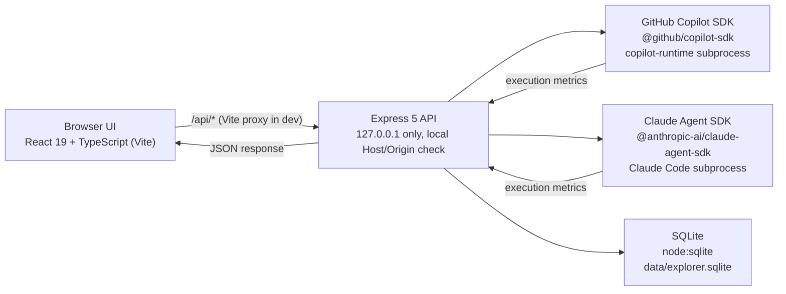

# GitHub Copilot Feature & Usage Explorer

A local, single-user dashboard that runs the **same task** through the **GitHub Copilot SDK** and the **Claude Agent SDK**, side by side, and shows the usage metrics each provider actually reports — model, tokens, duration, AI Credits, and an estimated Claude cost in USD.

The application's interface is in Turkish (it was built for a Turkish-speaking audience); this documentation is in English.


## Table of contents

1. [Application overview](#application-overview)
2. [Problem statement and objectives](#problem-statement-and-objectives)
3. [Key features](#key-features)
4. [Application sections explained](#application-sections-explained)
5. [Architecture and request lifecycle](#architecture-and-request-lifecycle)
6. [Technology stack](#technology-stack)
7. [Installation and local setup](#installation-and-local-setup)
8. [Environment variables and configuration](#environment-variables-and-configuration)
9. [Running the frontend and backend](#running-the-frontend-and-backend)
10. [How the Copilot SDK integration works](#how-the-copilot-sdk-integration-works)
11. [How Claude integration works](#how-claude-integration-works)
12. [Usage metrics, token accounting and AI credit limitations](#usage-metrics-token-accounting-and-ai-credit-limitations)
13. [Security considerations](#security-considerations)
14. [API endpoints](#api-endpoints)
15. [Vercel demo deployment](#vercel-demo-deployment)
16. [Testing and build verification](#testing-and-build-verification)
17. [Troubleshooting](#troubleshooting)
18. [Known limitations and future improvements](#known-limitations-and-future-improvements)
19. [License](#license)

## Application overview

This project is a demo/evaluation tool for teams deciding how to use GitHub Copilot, and for comparing it against the Claude Agent SDK on the same task. It runs entirely on your own machine (`127.0.0.1`), using your own GitHub Copilot login and, optionally, your own Anthropic API key. No request is sent anywhere when the page loads — every provider call only happens when you explicitly click a run button.

## Problem statement and objectives

Teams evaluating "should we use GitHub Copilot, and how" usually have to read vendor marketing pages, guess at token costs, and manually compare a second provider. This project exists to make that evaluation **empirical and local**:

- Run the same prompt through Copilot and/or Claude and look at the metrics each SDK actually returns, instead of estimating from documentation alone.
- Keep a persistent, inspectable history of every run (model, tokens, duration, cost) instead of relying on memory or screenshots of a billing dashboard.
- Separate **real measurements** (what the SDK reported) from **estimates** (USD cost, license calculations) and from **rule-based guidance** (mode advisor) — and label each one as such in the UI.
- Document GitHub Copilot's feature surface (Chat, Agent Mode, Skills, subagents, Fleet, MCP, Hooks, session limits, model selection) in one place, in plain language.

It is **not** a production multi-tenant product, a billing dashboard, or a benchmark suite with statistically validated results. Any number shown is either a direct SDK measurement for that one run, or an explicitly labeled estimate/heuristic.

## Key features

| Section | What it does | Data type |
|---|---|---|
| **Playground** | Runs a task on Copilot only, Claude only, or (after confirmation) both. Shows the actually-used model and metrics. | Real measurement (SDK); the Claude USD figure is an estimate |
| **Usage Analytics** | Details of the latest Copilot run (model breakdown, context window, event timeline), a live Copilot quota snapshot, and persistent run history with filtering, drill-down and confirmed clearing | Real measurement; quota is an experimental, point-in-time value |
| **Model Advisor** | Suggests Chat / Agent / Skill / MCP / Fleet based on task characteristics. Makes no model call. | Rule-based |
| **Comparison Lab** | Runs the same task with Copilot's Normal, Skill, Subagents and Fleet strategies in separate sessions and tabulates the result | Real measurement |
| **Licensing & Cost** | Calculates seat cost and AI Credit usage separately; can derive expected usage from the last real measurement | Estimate; plan prices are manually entered from vendor docs |
| **Reports & Backlog** | Generates a per-provider report from recorded history (how many runs reported each metric) and lists the improvement backlog | Derived from recorded real data |
| **Feature Guide** | Explains Chat, Agent Mode, Skills, subagents, Fleet, MCP, Hooks, session limits and model selection | Informational |

Every section and card in the UI carries an explicit label for its data type: *real measurement*, *estimate*, *example/assumption*, *rule-based*, or *informational*. The sidebar reads the real `/api/health` response every 30 seconds to show Copilot, Claude and database status.

## Application sections explained

### Playground

You type a task description, choose which provider(s) to run it on (Copilot, Claude, or both — running both requires an extra confirmation step since it may incur cost on both sides), optionally choose a Copilot execution strategy (Normal / Skill / Subagents / Fleet) and a model, and submit. The result card shows the provider's actual response and its reported metrics.

For Copilot, the UI distinguishes the **requested** model (what you selected, which may be `auto`) from the **actually used** model (what the SDK reports after the run) — the runtime, not the application, makes the final model choice when `auto` or an auto-routing tier is selected.

Errors are shown with the server's coded response (`error`, `code`, optional `setupHint`). If Copilot is unavailable (CLI not running, not authenticated) or Claude is not configured (missing/invalid API key), the relevant panel reports that state instead of silently failing or guessing a result.

### Usage Analytics

This section explains each metric exactly as the backend records it — it does not claim access to GitHub's organization-wide Copilot billing or usage data; it only shows what the SDK reports for runs made through this application:

- **Input / output tokens** — reported directly by the provider's SDK when available.
- **Total tokens** — the sum of the above, only computed when both are known.
- **Duration (ms)** — wall-clock time for the run as measured by the server.
- **Model calls** — how many underlying model invocations the run made (can be >1 for Skill/Subagents/Fleet strategies).
- **AI Credits (Copilot)** — the SDK's own `totalNanoAiu` measurement, converted to AI Credit units (10⁹ nano-AIU = 1 AI Credit). This is a consumption unit, not a currency.
- **Estimated cost in USD (Claude)** — the Claude Agent SDK's own `total_cost_usd`, computed from the SDK's price table. This is an **estimate**, not an invoice; the real amount is in Anthropic Console → Usage/Billing.

Any metric the provider does not report is shown as "Unknown" and is excluded from totals — it is never silently treated as zero. Every report in the Reports section states, for each metric, how many of the successful runs actually reported a value for it.

### Model Advisor

The advisor is a fixed decision tree (`server/services/advisor.ts`), not a model call and not a learned or benchmarked recommendation. It asks structured yes/no questions (file changes needed? terminal needed? multiple independent domains? parallelizable? sequential dependencies? reusable instructions? external service? deterministic checks needed?) and a complexity estimate, and returns one of: Simple Chat, Agent, Agent + Skill, Agent + MCP, Agent + Subagents, or Fleet/Orchestration, plus supporting recommendations, a cost category (low/medium/high), and warnings (e.g. "parallel execution may not suit this task's sequential dependencies").

Treat its output as a starting heuristic for discussion, not as a benchmarked or objectively verified performance result — it has not been validated against real task outcomes.

### Comparison Lab

This section runs the **same prompt** through Copilot's four execution strategies (Normal, Skill, Subagents, Fleet) in separate sessions and places the results in one table, or (from the Playground) runs Copilot and Claude independently on the same prompt.

When comparing **across providers** (Copilot vs. Claude), be aware that several things differ beyond just "the model":

| Dimension | Copilot | Claude |
|---|---|---|
| Platform | GitHub Copilot (your logged-in GitHub account) | Anthropic API (your Console account) |
| SDK / runtime | `@github/copilot-sdk`, talking to the Copilot CLI | `@anthropic-ai/claude-agent-sdk`, spawning a Claude Code subprocess |
| Model | Chosen from the account's catalog, or `auto` | Chosen from `supportedModels()`, or the SDK default |
| Authentication | Your machine's GitHub Copilot CLI login | `ANTHROPIC_API_KEY` in `.env` |
| Token accounting | SDK-reported input/output tokens, no cache breakdown surfaced | SDK-reported input/output/cache tokens |
| Billing unit | AI Credits (a consumption unit under your Copilot plan) | USD (API billing against your Console balance) |

AI Credits and USD are **never converted or summed** — the comparison summary and reports always show them as separate units. If a provider is not configured (e.g. no Anthropic API key), its panel explains what is missing and what remains unavailable; it does not fabricate a result for it.

### Licensing & Cost

This section keeps three distinct things separate, since conflating them is a common and costly mistake:

1. **Seat subscription cost** — what your organization pays per Copilot seat per billing cycle (manually entered from GitHub's published plan pricing, with a `lastVerified` date; this may have changed since).
2. **AI Credit usage** — consumption against whatever credit allowance your plan includes, which the calculator can derive from your last real measured run if you choose.
3. **Claude API billing** — a **separate, pay-as-you-go** Anthropic Console balance, billed by token price for the model used. **A Claude Pro/Max subscription or Claude Code access does not cover or waive this API usage; it requires a Console account with credit or billing configured.** Likewise, a GitHub Copilot seat does not grant Anthropic API access.

No price or quota figure here is invented: plan data comes from GitHub's own documentation (dated, see `server/data/copilot-plans.ts`), and every computed result states whether each input came from that plan data or from a value you entered yourself. The application never displays your actual invoice amount — it computes an estimate from the inputs you give it.

### Feature Guide

A plain-language reference card for each Copilot capability relevant to this evaluation: Chat, Agent Mode, Skills, custom/subagents, Fleet/Orchestration, MCP, Hooks, session limits, and model selection. Each card states what the capability is, when to use it, when to avoid it, and what drives its cost — for example, Skills add reusable instructions to context (which can increase token usage), MCP connects a session to external tools (disabled in this demo's Copilot sessions for isolation), and session limits are enforced by the SDK itself, not simulated by this application.

## Architecture and request lifecycle



**Request lifecycle for a Playground run:**

1. The browser posts to `/api/copilot/chat`, `/api/claude/chat`, or `/api/compare` with the prompt, strategy and model selection.
2. `server/app.ts` validates the request body (prompt length, strategy enum, model format) and checks the `Host`/`Origin` headers are local.
3. For Copilot, `server/services/copilot-runner.ts` opens an isolated session via `copilot-runtime.ts`, runs the prompt with the selected strategy, and collects the SDK's reported usage.
4. For Claude, `server/services/claude.ts` spawns a single-turn, tool-less Claude Agent SDK session, enforces a request timeout via `AbortController`, and collects the SDK's reported usage and cost estimate.
5. On success, the normalized execution is persisted via `server/services/usage-history.ts` (SQLite by default) and returned to the browser. On failure, a coded error (and a failed history entry) is returned instead — a Copilot failure never blocks or corrupts the Claude result, and vice versa.
6. The Usage Analytics and Reports sections read back from the same history store.

| Layer | Files |
|---|---|
| Server entry | `server/index.ts` (env, persistence, Copilot client, listen, shutdown) |
| HTTP app | `server/app.ts` (`createApp`: routes, validation, error responses; also used by tests with fake providers) |
| Copilot | `server/services/copilot-runner.ts` (run, catalog, quota), `copilot-runtime.ts` (security, timeout, connection, error codes) |
| Claude | `server/services/claude.ts` (run, model listing, status, isolation, error codes) |
| History & reports | `server/services/usage-history.ts`, `usage-report.ts`, `server/db/*.ts` |
| Other services | `advisor.ts`, `licensing.ts`, `provider-comparison.ts`, `server/data/copilot-plans.ts` |
| Demo mode (Vercel) | `server/demo/*.ts`, `api/**/*.ts` — see [Vercel demo deployment](#vercel-demo-deployment) |
| Frontend | `src/App.tsx`, `src/sections/*`, `src/components/*`, `src/content/*`, `src/lib/*` |
| Tests | `tests/*.test.ts` (Node test runner; no real provider calls) |

## Technology stack

- **Frontend:** React 19, TypeScript, Vite 8.
- **Backend:** Express 5, Node.js (`>=22.13.0`), `node:sqlite` (built-in, experimental).
- **Providers:** `@github/copilot-sdk` (GitHub Copilot CLI control), `@anthropic-ai/claude-agent-sdk` (Claude Code subprocess control).
- **Config:** `dotenv`.
- **Tooling:** ESLint, TypeScript project references (`tsc -b`), Node's built-in test runner.

No new runtime dependency was introduced by this documentation/deployment pass; the demo mode reuses the same dependency-injection pattern already used by the test suite (`CopilotService` and `claudeQueryFn` injection points in `server/app.ts`).

## Installation and local setup

### Prerequisites

- **Node.js `>=22.13.0`** (required for the built-in `node:sqlite` module; Node 24 recommended) and npm.
- **GitHub Copilot access:** the Copilot SDK uses the GitHub account logged in on your machine (`useLoggedInUser: true`). You need to be logged in via the Copilot CLI. If Copilot is unavailable, the app still starts and reports its state; Copilot endpoints degrade gracefully.
- **Claude (optional):** an Anthropic Console API key with credit/billing configured on the Console account (see [How Claude integration works](#how-claude-integration-works)).

### Setup

```sh
git clone https://github.com/silassaatli/github-copilot-feature-usage-explorer.git
cd github-copilot-feature-usage-explorer/copilot-usage-dashboard
npm install
cp .env.example .env      # Windows PowerShell: Copy-Item .env.example .env
```

Then edit `.env` (see the next section) and continue to [Running the frontend and backend](#running-the-frontend-and-backend).

## Environment variables and configuration

The server reads `.env` at startup (via `dotenv`). Restart the server after changing it. `.env.example` contains only empty values and comments — never put a real key there.

| Variable | Default | Description |
|---|---|---|
| `ANTHROPIC_API_KEY` | — | Anthropic Console API key for Claude (usually `sk-ant-api…`). If empty, Claude shows as "Not configured". OAuth (`sk-ant-oat…`) and Admin (`sk-ant-admin…`) keys are rejected. |
| `CLAUDE_AGENT_MODEL` | SDK default | Claude model used when none is selected in the UI: an alias (`haiku`, `sonnet`, `opus`, `fable`) or a full model id. |
| `CLAUDE_AGENT_EFFORT` | model default | `low`, `medium`, `high`, `xhigh`, `max`. |
| `CLAUDE_REQUEST_TIMEOUT_MS` | `120000` | Claude run timeout (1000–900000). |
| `COPILOT_REQUEST_TIMEOUT_MS` | `120000` | Copilot run timeout (1000–900000). |
| `PORT` | `3001` | API port. The dev proxy expects `3001`; update `vite.config.ts` if you change it. |
| `DATABASE_PATH` | `data/explorer.sqlite` | SQLite file path. The folder is created if missing. |
| `HISTORY_RETENTION` | `1000` | Maximum number of runs retained (10–100000). |

No variable is required for Vercel's demo mode — see [Vercel demo deployment](#vercel-demo-deployment).

## Running the frontend and backend

| Command | What it does |
|---|---|
| `npm run dev` | Starts the API (`127.0.0.1:3001`, restarts on file changes) and the Vite frontend (`http://localhost:5173`) together. Open **http://localhost:5173**. |
| `npm run build` | TypeScript checks for frontend, server and tests, plus a production build into `dist/`. |
| `npm run serve` | Serves the built frontend and the API from one process: **http://127.0.0.1:3001** (run `npm run build` first). |
| `npm start` | Starts only the API (no frontend). |
| `npm run preview` | Vite preview server (static frontend only; run the API separately). |

Stop the server with `Ctrl+C`. The dev server runs with `node --watch --import tsx`; `tsx watch` is not used because it deadlocks the server while the Claude SDK loads under `concurrently` on Windows.

## How the Copilot SDK integration works

- Each session opens in an empty, temporary directory (`server/services/copilot-runtime.ts`).
- The agent can only use the SDK's `BuiltInTools.Isolated` in-session tools (subagent, skill, task completion). File, shell, network and MCP tools are disabled.
- Every permission request is denied automatically — there is no interactive approval flow.
- When the run finishes, the session is closed with `disconnect` + `deleteSession` and the temporary directory is removed; a cleanup failure never masks the original error.
- On timeout, or if the client disconnects before the response completes, `session.abort()` is called.
- The model catalog (`/api/copilot/models`) comes from the account's and session's catalog; a session opens and closes just to read it, with no prompt sent. Some accounts/plans only expose `auto` — the UI states this explicitly rather than inventing named models. Requesting a model not in the account's catalog returns `UNSUPPORTED_MODEL`.
- If the Copilot CLI cannot start, the app stays up in degraded mode: Copilot endpoints return `503 / COPILOT_UNAVAILABLE` and the server retries connecting after a cooldown. This never affects Claude's availability or the rest of the app.

## How Claude integration works

- Claude runs are made through `@anthropic-ai/claude-agent-sdk`, which spawns a local Claude Code subprocess per run.
- Authentication is **exclusively** the `ANTHROPIC_API_KEY` from your server-side `.env` file. The server inspects the SDK's reported `apiKeySource` for each run and aborts (`CLAUDE_CREDENTIAL_SOURCE`) if the subprocess ends up authenticated by anything else (e.g. a pre-existing `claude.ai` session or inherited CLI credentials) — `CLAUDE_CONFIG_DIR` is redirected to a temporary directory specifically to prevent your machine's own `~/.claude` session from being picked up. Parent-process `CLAUDE_*`/`ANTHROPIC_*` environment variables and GitHub tokens are stripped before the subprocess starts.
- The session runs tool-less (`tools: []`), single-turn, non-persistent, in an isolated temporary working directory. Timeout and cancellation are enforced with an `AbortController`.
- Model listing (`/api/claude/models`) opens an idle session (no prompt sent) purely to call the SDK's `supportedModels()`, and caches the result for 10 minutes.
- **The default model can be expensive.** The SDK's `default` alias may resolve to an Opus-class model. The UI flags this and suggests a lower-cost model (e.g. Haiku) for demo purposes; the application never silently substitutes a model for you.
- Connection states exposed via `/api/claude/status`: `missing_key`, `invalid_key_format`, `sdk_unavailable`, `unverified` (key present, not yet exercised), `verified` (a real run with this exact key succeeded), `auth_failed` / `error` (the last real run failed). Only a successful real run counts as "verified" — the mere presence of a key does not.

## Usage metrics, token accounting and AI credit limitations

| Value | Source | Meaning |
|---|---|---|
| Tokens, model/turn calls, duration, actually-used model | Provider SDK | **Real measurement.** If the provider does not report a value, it is shown as "Unknown" and excluded from totals (never assumed to be zero). Reports state, per metric, how many successful runs reported it. |
| **AI Credits** (Copilot) | Copilot SDK `totalNanoAiu` (10⁹ nano-AIU = 1 AI Credit) | **SDK-measured consumption.** Not a currency. |
| **Estimated cost (USD)** (Claude) | Claude Agent SDK `total_cost_usd` | **Estimate**, computed from the SDK's price table — not an invoice. The real amount is in Anthropic Console → Usage/Billing. |
| License calculator | `server/data/copilot-plans.ts` (manually entered from GitHub's docs, with a last-verified date) plus your own inputs | **Estimate.** Seat price, included credits and expected usage are editable; every result states whether each figure came from plan data or from your input. |
| Copilot quota | Experimental SDK account RPC | **Point-in-time value**, fetched on request; not continuously monitored or historized. |

AI Credits and USD are never converted into one another or summed. This application never displays your real invoice amount.

## Security considerations

- **Local-only access:** the API only listens on `127.0.0.1`. A request is rejected with `403` if its `Host` header (or, when present, its `Origin` header) is not local — this stops another website (via DNS rebinding or a cross-origin form submission) from triggering a billable model call without your knowledge. (This check is disabled in the public [Vercel demo mode](#vercel-demo-deployment), which uses fake providers and incurs no cost.)
- **Copilot sessions:** opened in an empty temporary directory; restricted to isolated, tool-less in-session capabilities; every permission request denied; closed and cleaned up after each run, even on error; aborted on timeout or client disconnect.
- **Claude sessions:** tool-less, single-turn, non-persistent, isolated working directory and environment; timeout/cancellation via `AbortController`.
- **Provider independence:** a Copilot or Claude failure never affects the other provider's result, the history record, or the rest of the app.
- **Error responses:** shaped as `{ error, code, setupHint? }` with a fixed set of codes (`COPILOT_AUTH_REQUIRED`, `COPILOT_RATE_LIMITED`, `COPILOT_TIMEOUT`, `SESSION_LIMIT_REACHED`, `CLAUDE_NOT_CONFIGURED`, `CLAUDE_AUTH_FAILED`, `CLAUDE_BILLING`, `CLAUDE_RATE_LIMITED`, `REQUEST_CANCELLED`, `FORBIDDEN_ORIGIN`, `CONFIRMATION_REQUIRED`, `NOT_FOUND`, `INVALID_JSON`, etc.). Raw SDK messages, file paths and request ids are never sent to the client. Failed runs are recorded in history with their error code.
- **API key handling:** the key is read only from the server-side `.env`. It is never written to the browser, API responses, server logs, or the database. Only a truncated SHA-256 fingerprint of the key is stored, to track verification state — the key itself cannot be recovered from it.

## API endpoints

| Method | Endpoint | Description |
|---|---|---|
| GET | `/api/health` | API, Copilot (starting / connected / not logged in / unavailable), Claude and database status |
| GET | `/api/copilot/models` | Copilot model catalog, `scope: auto-only \| named`, and auto-routing tiers |
| GET | `/api/copilot/quota` | Point-in-time quota (experimental SDK RPC) |
| POST | `/api/copilot/chat` | Run on Copilot (`prompt`, `model`, `autoTier`, `strategy`, `maxAiCreditLimit`) |
| POST | `/api/copilot/fleet` | Experimental Fleet run |
| GET | `/api/claude/status` | Claude connection status (never includes the key value) |
| GET | `/api/claude/models` | Claude Agent SDK model list (`?refresh=1`); makes no model call |
| POST | `/api/claude/chat` | Run on Claude (`prompt`, `claudeModel`) |
| POST | `/api/compare` | Runs selected providers independently (`providers`, plus Copilot/Claude model selection) and returns a common-metric summary |
| GET | `/api/usage/history` | History (`?provider=github-copilot\|claude`, `?status=success\|error`, `?limit=` up to 200); includes `storage`, `persistent`, `total` |
| DELETE | `/api/usage/history` | Clears all history; requires body `{ "confirm": true }` |
| GET | `/api/usage/summary` | Per-provider report derived from recorded history |
| POST | `/api/advisor/recommend` | Rule-based mode recommendation |
| GET | `/api/licensing/plans` | Plan data, sources and last-verified date |
| POST | `/api/licensing/calculate` | License/cost calculation (`plan`, `seats`, `expectedCreditsPerSeat`, optional `includedCreditsPerSeat`, `seatPriceUsd`) |

All of the above are implemented identically in the production server (`server/app.ts`) and in the Vercel demo deployment — the demo substitutes fake providers behind the same routes, it does not expose a different API surface.

## Vercel demo deployment

The real application requires a GitHub account already logged in via the Copilot CLI on the host machine, and a writable, persistent filesystem for SQLite history. Neither assumption holds on Vercel's serverless runtime, so **this project is not deployed to Vercel in its real-provider configuration.** Instead, `vercel.json` and `api/[...slug].ts` publish a **demo mode** that exercises the exact same API surface against fake, in-process providers.

### What demo mode is

- `server/demo/fake-providers.ts` implements the same `CopilotService` interface and Claude `queryFn` injection point that the test suite already uses to avoid real provider calls (see `tests/api.test.ts`). It requires no API key and no Copilot/GitHub login, and makes no network call to GitHub or Anthropic.
- `server/demo/create-demo-app.ts` builds the Express app (`createApp` from `server/app.ts`) with these fake providers, an in-memory history store (`persistent: false` — it resets on every cold start/redeploy), and `trustedHosts: 'any'`, which lifts the local-only `Host`/`Origin` restriction. Lifting that restriction is safe here specifically because there is no real key or account behind it to abuse.
- `api/_demo-app.ts` builds a single shared instance of this demo Express app. Every other file under `api/` re-exports that same instance as its default export, so Express still does the actual method/path routing internally regardless of which physical file Vercel invoked. Files prefixed with `_` are excluded from Vercel's routing by convention, so `_demo-app.ts` itself is never exposed as a route.
- There are 7 route-bearing files, kept deliberately few (the Hobby plan caps Serverless Functions per deployment): `api/health.ts`, `api/compare.ts`, and one nested catch-all per resource group — `api/copilot/[...slug].ts`, `api/claude/[...slug].ts`, `api/usage/[...slug].ts`, `api/advisor/[...slug].ts`, `api/licensing/[...slug].ts` — each matching every route under that prefix (e.g. `/api/copilot/models`, `/api/copilot/quota`, `/api/copilot/chat`, `/api/copilot/fleet` all go through `api/copilot/[...slug].ts`). A single **root-level** `api/[...slug].ts` catching all of `/api/*` was tried first and found, by testing the live deployment, to only match single-segment paths (`/api/health` reached the function, `/api/copilot/models` returned Vercel's own platform 404) — nesting the catch-all one level under a literal resource directory, so it only has to match the single trailing segment, avoided that.
- Every demo response is explicitly labeled: health messages state "Demo mode: fake Copilot provider (no real account used)" and "Demo mode: history is kept in memory, not persistent", and every generated run response is prefixed `[Demo]` and states it is not a real model reply.

**Demo responses must not be read as real Copilot or Claude usage, cost, or performance data.** They are fixed, synthetic numbers meant only to exercise the UI end to end.

### Supported endpoints in demo mode

Every endpoint listed in [API endpoints](#api-endpoints) responds in demo mode, backed by fake data instead of a real provider:

- `/api/health`, `/api/copilot/models`, `/api/copilot/quota`, `/api/copilot/chat`, `/api/copilot/fleet` — served by the fake Copilot service.
- `/api/claude/status`, `/api/claude/models`, `/api/claude/chat` — served by the fake Claude `queryFn`.
- `/api/compare` — runs both fake providers independently and returns the same comparison summary shape as production.
- `/api/usage/history`, `/api/usage/summary`, `/api/advisor/recommend`, `/api/licensing/plans`, `/api/licensing/calculate` — unchanged; history is just in-memory instead of SQLite.

### Deployment steps

1. Push this repository to GitHub (already required for a Vercel import).
2. In the Vercel dashboard: **Add New → Project**, select this repository.
3. Set **Root Directory** to `copilot-usage-dashboard` (the app lives in this subdirectory, not the repo root).
4. Leave the framework preset as "Other" — `vercel.json` already declares `buildCommand: npm run build` and `outputDirectory: dist`.
5. No environment variables are required or used by demo mode.
6. Deploy.

### Limitations of demo mode

- **No real provider is exercised.** No actual Copilot or Claude usage, latency, model routing, or cost is measured — all numbers are fixed, synthetic values set in `server/demo/fake-providers.ts`.
- **History does not persist.** It is held in the serverless function's memory and is lost on every cold start or redeploy.
- **The local-origin security check is disabled.** This is intentional and limited to the fake-provider path — there is no real key or billable account reachable through it, so there is nothing for a third-party site to abuse.
- **This deployment has not been verified against a live Vercel project in this change.** Local verification is described in [Testing and build verification](#testing-and-build-verification); an actual Vercel deployment must be performed and confirmed by whoever has access to the target Vercel account (see the final report accompanying this change for exactly what was and was not verified).

If a deployment with **real** provider calls is required, the architecture needs to change: Copilot's local-login requirement may not be solvable in a serverless context at all, Claude would need a key-based backend reachable from a server environment, and history would need an external database (e.g. Vercel Postgres, Supabase) instead of local SQLite.

## Testing and build verification

| Command | Scope |
|---|---|
| `npm run test:unit` | 74 automated tests: API endpoints (valid/invalid requests, model-selection passthrough, health, provider-error isolation, history filtering/deletion, reports, local-access guard, startup without a database, production static serving, key never appearing in responses/logs), Copilot session security, Claude integration, SQLite migrations and persistence, reports, licensing, advisor. |
| `npm run typecheck` | TypeScript checks for frontend, server, tests and scripts. |
| `npm run lint` | ESLint. |
| `npm run build` | Production build. |

These tests make **no network call and require no API key** — Copilot and Claude are exercised through fake services and a fake SDK query function, the same pattern the Vercel demo mode reuses.

> ⚠️ `npm run test:copilot-sdk` opens a real Copilot session and sends a message — it **consumes real Copilot usage (AI Credits)**. It is not part of the automated test suite and should only be run deliberately. There is no automated test that makes a real Claude call.

As part of preparing this documentation/deployment change, the following were run and passed locally: `npm run test:unit` (74/74 passing), `npx tsc -p tsconfig.server.json` (no errors), `npm run lint` (no issues), and `npm run build` (succeeds, produces `dist/`). The demo app was also exercised directly with a non-localhost `Host` header against `/api/health` and `/api/compare`, confirming both endpoints respond `200` with clearly demo-labeled data.

## Troubleshooting

- **"Copilot kullanılamıyor" / Copilot unavailable in the sidebar:** you are not logged in to the Copilot CLI on this machine, or your plan/policy does not grant access. Log in with the Copilot CLI and restart the server; the app runs in degraded mode in the meantime, with Copilot endpoints returning `503 / COPILOT_UNAVAILABLE`.
- **Claude shows "Yapılandırılmamış" (not configured):** `ANTHROPIC_API_KEY` is missing from `.env`. Add it and restart the server.
- **Claude shows "Anahtar türü uygun değil" (invalid key format):** you supplied an OAuth (`sk-ant-oat…`) or Admin (`sk-ant-admin…`) key. Only an API key (`sk-ant-api…`) from Anthropic Console → API Keys works here.
- **Claude run fails with `CLAUDE_CREDENTIAL_SOURCE`:** the Claude Code subprocess authenticated with something other than your `.env` key (e.g. a pre-existing local `claude.ai` session). This is enforced intentionally; check that no other `CLAUDE_*`/`ANTHROPIC_*` credentials are being inherited from your shell.
- **`ExperimentalWarning: SQLite is an experimental feature`** at startup: expected on Node 24 — `node:sqlite` is still flagged experimental upstream. It does not indicate a problem.
- **Dev server hangs or the API process seems stuck on Windows:** this is why `dev:server` uses `node --watch --import tsx` instead of `tsx watch` — the latter was observed to deadlock the server while the Claude SDK loads under `concurrently` on Windows. If you changed this, revert to the documented script.
- **Port already in use:** another process is bound to `3001` (or your configured `PORT`). Stop it, or set a different `PORT` in `.env` and update the proxy target in `vite.config.ts` to match.
- **`UNSUPPORTED_MODEL` from `/api/copilot/chat`:** the requested model is not in your account's catalog (some accounts/plans only expose `auto`). Check `/api/copilot/models` for what is actually available to you.
- **Database cannot be opened (permission, lock, corrupt path):** the server does not crash; history falls back to an in-memory store that is lost on restart, and `/api/health` reports `services.database.persistent: false`.

## Known limitations and future improvements

This list mirrors the application's own **Reports & Backlog** section (`src/content/backlog.ts`); it is a usage/improvement backlog, not a separate project-management system.

**Completed**
- Running Copilot and Claude side by side, independently, with a common-metric comparison.
- Showing only metrics the provider actually reported — unknown values are never treated as zero.
- Real Copilot and Claude model selection from live endpoints, passed through to the backend request.
- Persistent, filterable, drillable, confirm-to-clear history in SQLite; reports derived from recorded data.
- Secured sessions (temporary directory, tool restriction, permission denial), timeout and cancellation, isolated Claude subprocess, local-access guard.
- Resilient startup and explicit status reporting even when Copilot or the database is unavailable.

**Known limitations**
- The Copilot model catalog depends on the account; some accounts only expose `auto`.
- Claude's cost is an SDK estimate; the real invoice is in Anthropic Console.
- Plan prices and credit allowances are manually entered from vendor docs (with a `lastVerified` date) and may have changed since.
- Quota is a point-in-time value from an experimental RPC; no history is kept for it.
- Fleet, the quota RPC, and `node:sqlite` are all experimental components.
- Per-model token breakdown for Claude is not yet written to the `model_usage` table.
- Built for local, single-user use; there is no multi-user authentication.
- No automated component tests for the frontend. The UI was verified through the build, the API test suite, and manual checks at desktop and 390px mobile widths.
- The Vercel demo mode (added in this change) has not been verified against a live Vercel deployment — only locally, against the same Express app the deployment uses.

**Suggested next steps**
- Time-series charts from real historical measurements.
- Recording Claude's per-model token breakdown.
- Exporting history and reports as CSV/JSON.
- Historizing optional quota snapshots using the existing migration mechanism.
- A periodic check comparing plan prices against their source documents.
- Frontend component tests (requires an additional dependency).
- Verifying the Vercel demo deployment end to end against a live project.

## License

This repository does not currently include a license file. Until one is added, no reuse rights beyond GitHub's Terms of Service are granted. Open an issue or contact the repository owner if you need to use this code under a specific license.
